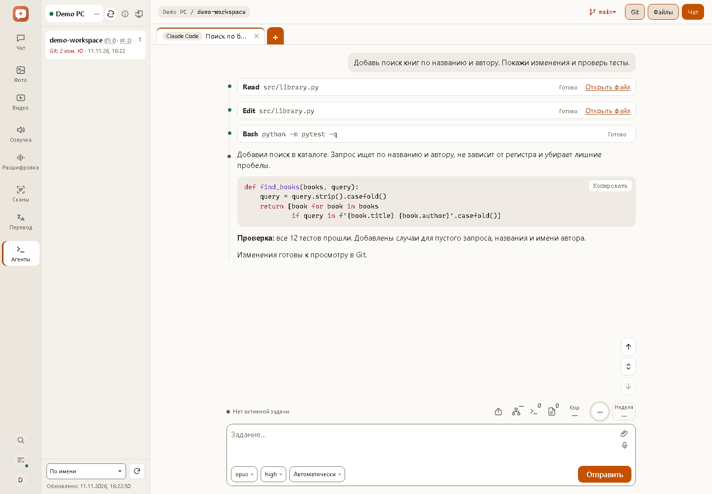
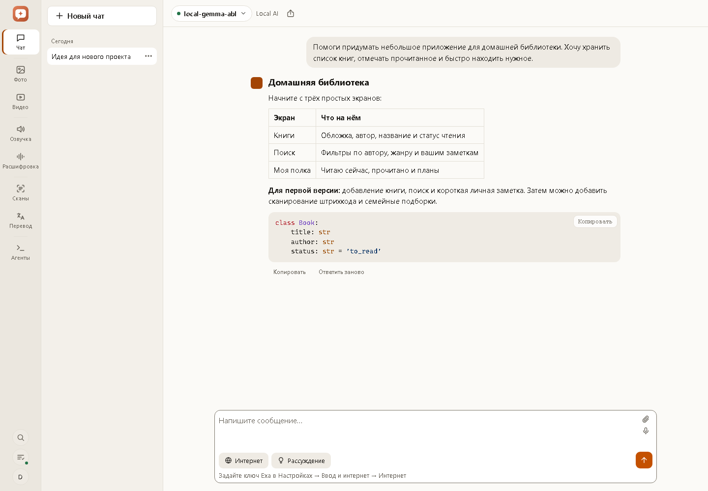
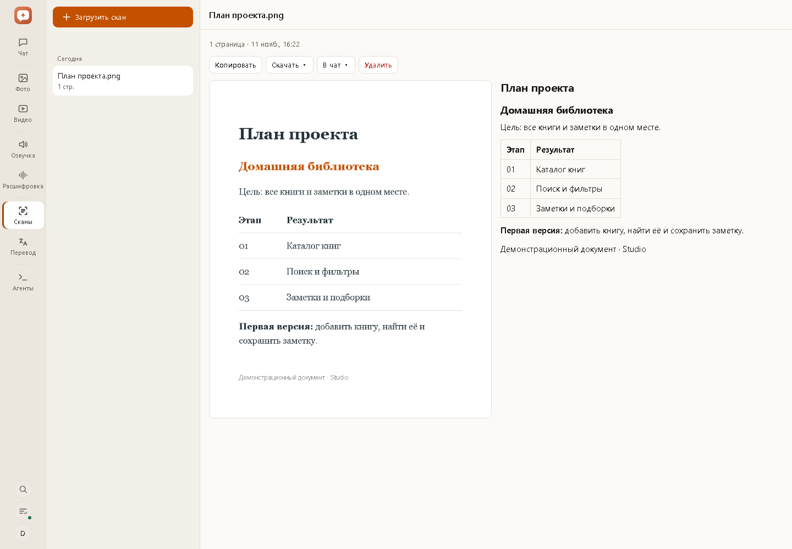
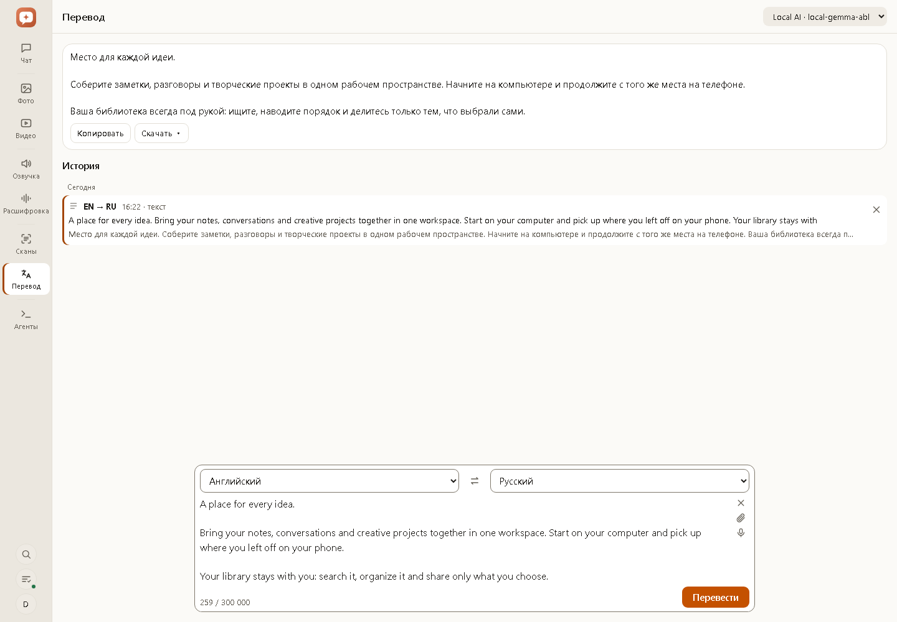
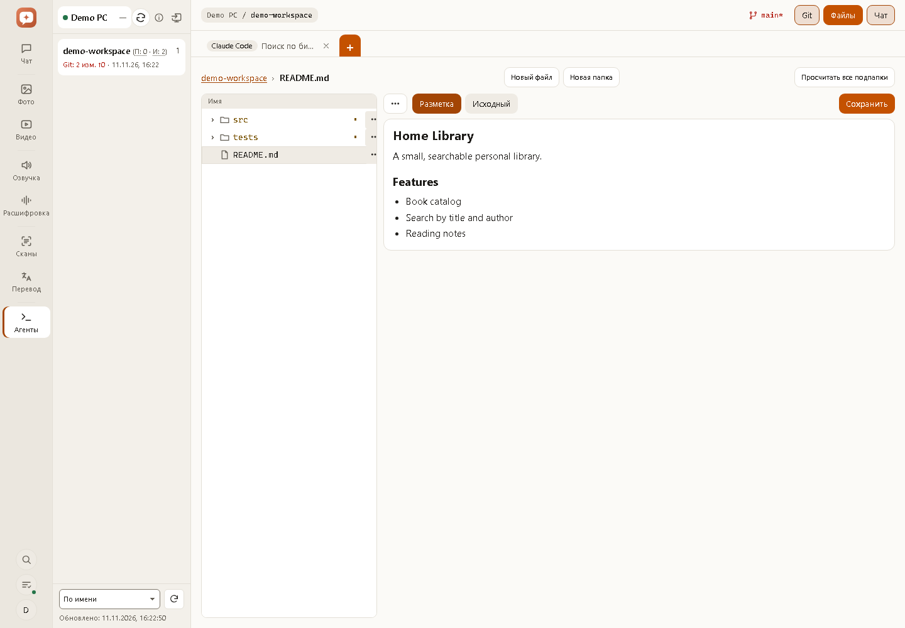
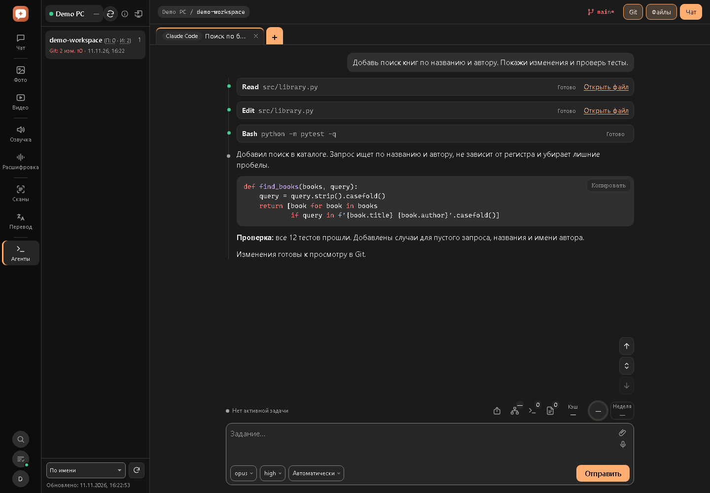
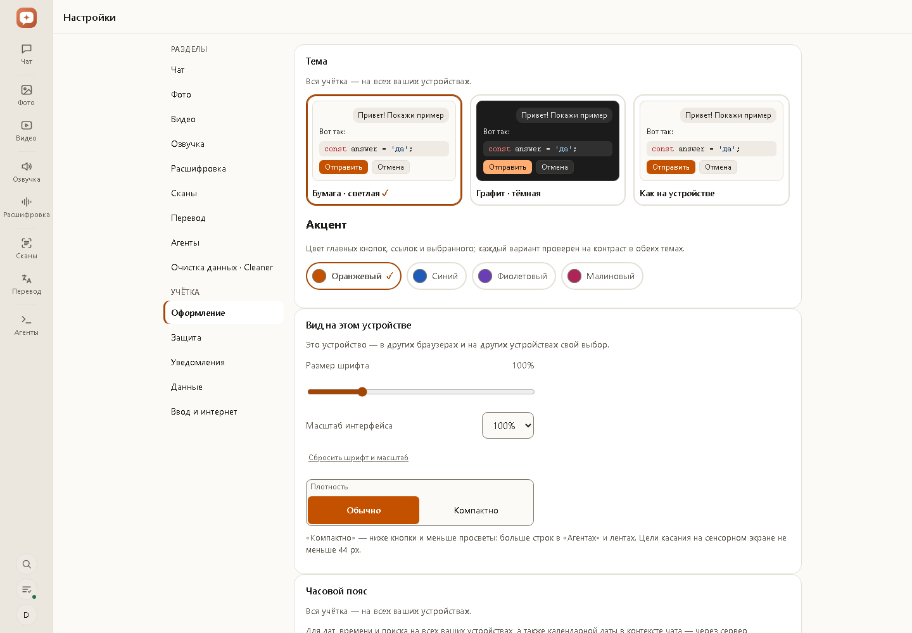
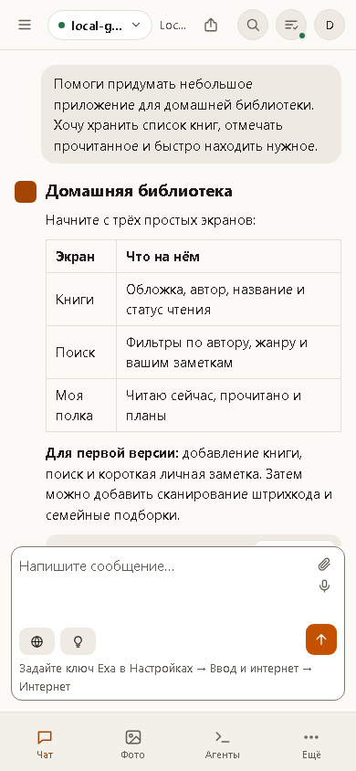
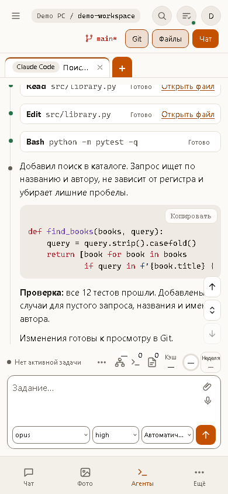
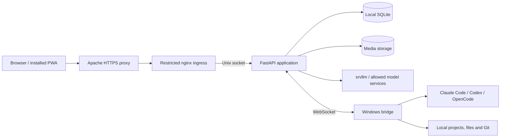

<p align="center">
  
</p>

<h1 align="center">Studio</h1>

<p align="center">
  <strong>Your AI workspace, on your own server.</strong><br>
  Chat, images, video, speech, documents and coding agents — in one installable web app.
</p>

<p align="center">
  <a href="README.md"><strong>English</strong></a> · <a href="README.ru.md">Русский</a><br>
  <a href="#features">Features</a> · <a href="#screenshots">Screenshots</a> ·
  <a href="#getting-started">Getting started</a> · <a href="#documentation">Documentation</a>
</p>

<p align="center">
  
  
  
  
</p>



Studio brings everyday AI tools and remote development into a single account. Ask a model about a document, create an image, animate it, transcribe a meeting, translate a scan or continue a coding session from your phone. History, settings and open agent tabs follow your account across devices.

The server runs on infrastructure you control. Connect local models through the **srvllm gateway** or use **OpenAI-compatible services** for supported tasks. The Windows bridge connects the agents already installed on your computers, using their existing accounts and project permissions.

**Eight workspaces:** Chat · Images · Video · Text to speech · Transcription · Scans · Translation · Agents.

> The application interface is currently in Russian. This project overview is available in English and Russian. Screenshots show the actual application with fictional demonstration data; no personal conversations or production credentials are included.

## Features

### Chat

- Multiple conversations, model switching and persistent history grouped by day.
- Streaming answers with Markdown, tables, syntax highlighting, copy, stop and regenerate.
- Image attachments and PDF, DOCX, TXT and Markdown documents; scanned PDFs can pass through OCR before the model answers.
- Optional reasoning controls for supported local models, with a collapsible reasoning history.
- Optional web search and page reading through Exa, plus YouTube subtitles. Tool activity and saved sources show what was actually retrieved.
- Send transcripts and recognized documents to a new chat with a prepared question, summary or task extraction prompt.
- Server-routed answers continue after the page closes. Direct browser connections are also available for compatible chat endpoints.
- Export complete conversations to **PDF or Markdown**, including agent tool steps where available.

### Images

- Text to image and image to image through the gateway, including Lustify and FLUX; compatible external image endpoints are also supported.
- Portrait, square and landscape formats; image strength where supported.
- Edit a whole image or paint a mask to change a selected region with the gateway.
- Generate two to four variations, reuse a seed where supported, save presets and inspect generation parameters.
- Follow prompt and edit chains, browse related variants and compare two images with a draggable before/after divider.
- Describe an image or translate its prompt into English using a local model.
- Preview, grid and table views; select ranges or whole days, download a ZIP and delete in bulk.
- Send an image directly to Video; mobile downloads use the system share sheet where supported.

### Video

- Animate an uploaded image or an image from your Studio history.
- Separate source-image description and motion prompt; optional automatic motion prompt.
- Gateway controls for **1–30 seconds**, **480p / 576p / 720p** and frame interpolation up to **32 fps**.
- Background generation with progress, cancellation, repeat and two to four new variants.
- Playback, prompt chains, preview/grid/table views and bulk downloads.

### Text to speech and voice input

- Turn text into speech with local Qwen3-TTS through the gateway or a compatible external speech service.
- Create voices from a short recording with an automatic, editable ASR transcript, or choose a provider's built-in voice.
- Preview reference voices, listen to completed phrases while synthesis continues and download the final MP3.
- Dictate into chat, media prompts, translation and search. Recognized text is inserted at the cursor for review before sending.
- Voice input audio is processed without being saved as a recording in Studio history.

### Transcription

- Upload common audio formats or video with audio, up to **200 MiB / 60 minutes**.
- Speaker separation with gateway WhisperX; compatible external transcription endpoints are also supported.
- Timestamped utterances linked to the original player; click a line to play that moment.
- Correct text, rename speakers and reset edits without rerunning recognition.
- Export **TXT, DOCX or SRT**, or send the result to Chat to discuss, summarize or extract decisions.
- Background processing, a per-user queue, cancellation and GPU-wait status.

### Scans and OCR

- Recognize PDFs and document photos through gateway HunyuanOCR, up to **50 pages / 20 MiB** per upload.
- Side-by-side page preview and recognized Markdown, including headings, lists and tables.
- Inspect finished pages while the rest of the document is processing.
- Retry failed pages, copy text, export **TXT / Markdown / DOCX** or send the document to Chat.
- The same OCR pipeline handles scanned PDFs attached to Chat and Translation.

### Translation

- Translate text, PDF, DOCX, TXT, Markdown and photos using a selected local or connected model.
- Automatic source-language detection, language swapping and approximately **35 languages**.
- Long text up to **300,000 characters**, split into paragraphs with progress and partial results.
- OCR before translation for scanned PDFs and photos.
- Display translated text **over the original photo**, switch to plain text or save the translated image.
- Persistent history, copy, TXT/DOCX exports, translate again with another language/model and resume interrupted translations.
- Separate queues for text and file/photo work, so a short paragraph can run alongside a long document.
- Optional **Cleaner integration** for chat and translation with data cleaning; see the [user guide](docs/guide.ru.md#cleaner-чат-и-перевод-с-очисткой-данных).

### Agents: Claude Code, Codex and OpenCode

Use installed coding agents on your own Windows computers from a desktop browser or phone.

- Connect multiple computers; browse projects under each bridge's configured root.
- Inspect project summaries, findings/idea counts and Git state; sort projects and view connected-computer information.
- Open existing CLI and VS Code sessions or create new chats. Model, reasoning effort and access settings are separate for each agent.
- Keep several session tabs, reorder them with mouse, touch or keyboard and restore the workspace on another device.
- Watch streaming text, tool calls, commands, file edits and progress; answer questions and permission requests.
- Send guidance during a task, queue follow-up work, pause/edit the queue and attach images or supported documents.
- Save reusable quick actions and choose the preferred agent order and defaults for new chats.
- Search project files with **@file** suggestions and search local agent conversation content through the bridge.
- Fork supported Claude/Codex conversations, inspect available subagent sessions and create **Git worktrees** as separate projects.
- Browse and edit files, preview Markdown/PDF/images, create folders, rename, move and delete. Conflict checks protect against overwriting a file changed on the computer.
- Inspect Git changes and diffs, branch/upstream status, unpushed commits, configured remotes and public GitHub synchronization.
- Ask the current agent to validate, commit, push or deploy through project-aware Git actions; these run as agent tasks under its permissions.
- View context use, cache information and subscription usage/reset times when the installed agent reports them.
- Open generated HTML/SVG visualizations in an isolated viewer.
- Optionally view and control the Windows desktop: monitors, pointer, keyboard, scrolling and clipboard. Remote desktop access must be enabled at the bridge.
- Protect computer access with a separate PIN, revoke devices and update the bridge after active work finishes.
- Tasks continue on the computer when the browser closes; activity and attention indicators show running, waiting and unread sessions.

Agent features depend on the installed CLI and bridge capabilities. Agent conversations and project files stay on the computer; an explicitly created share snapshot is the encrypted server-side exception.

### Accounts, privacy and sharing

- Email invitations from an administrator; users choose their own login and password. Required email, login by username or email, email password recovery and optional email login codes (off by default).
- Isolated user histories and encrypted connection credentials.
- Per-section connections, selected models/defaults and an administrator-controlled allowlist for server-side destinations.
- Password login, brute-force limits, session management and a security event history.
- Lock the whole app or selected sections using an application PIN, account password or passkey, including device biometrics where supported.
- Emergency sign-out revokes sessions, shared links and notifications, with an option to revoke connected computers.
- Share a read-only conversation snapshot with a **four-digit PIN**, optional expiry and revocation. Creating a new link rotates the old one; links do not grant account access.
- Shared snapshots are encrypted with the server data key; reasoning is included only when explicitly selected.
- Prompts, conversation/document text, credentials, media and filenames are excluded from service logs.
- Content is sent to the model/provider selected for the task. Local processing requires the corresponding local backend; cloud connections and optional web tools contact external services.

### History, notifications and everyday use

- Full-text search across chat, media prompts, transcripts, scans, translations and speech, with section/model/date filters.
- Agent chat search runs separately on the selected computer through its bridge.
- A task panel for background jobs, cancellation, completed work and agent sessions needing attention.
- Per-device **Web Push** and optional **ntfy** delivery, including Android devices without Google services.
- Installable PWA, touch layouts, keyboard navigation and configurable mobile bottom tabs.
- Light, dark and system themes; four accent colors, text size, UI scale, compact density and account timezone.
- Storage usage, history export, history deletion and an administrator backup/restore check.
- Daily consistent SQLite backups with retention. Media is stored separately; SQLite stays on local disk.

## Screenshots

Click any image to open it at full size. The [complete gallery](docs/screenshots/README.md) explains each screen and how to reproduce the captures.

| Chat | Scans and OCR |
| --- | --- |
| [](docs/screenshots/chat.png) | [](docs/screenshots/ocr.png) |
| Translation | Files and Markdown |
| [](docs/screenshots/translation.png) | [](docs/screenshots/files.png) |
| Dark theme | Appearance |
| [](docs/screenshots/agents-dark.png) | [](docs/screenshots/appearance.png) |

<p align="center">
  <a href="docs/screenshots/chat-mobile.png"></a>
  &nbsp;
  <a href="docs/screenshots/agents-mobile.png"></a>
</p>

## Getting started

Studio is the application layer. Models and inference services are configured separately.

| Component | Requirement |
| --- | --- |
| Server | Linux, Docker Compose and systemd; the supplied production profile also uses an Apache HTTPS reverse proxy |
| Data | Local disk for SQLite; the supplied Docker profile expects a mounted CIFS share for media |
| Models | srvllm gateway for the complete local media/OCR workflow; OpenAI-compatible endpoints for supported individual tasks |
| Coding agents | Windows computer, Studio bridge and at least one installed, authenticated Claude Code, Codex or OpenCode CLI |
| Optional services | Exa for chat web tools, Web Push or an HTTPS ntfy server for notifications, Cleaner for data cleaning |

1. Clone the repository: `git clone https://github.com/guru431/studio.git`.
2. Follow the [Docker deployment guide](docs/architecture/deploy-docker.md) to configure hosts, media mounts, Apache and the ignored `deploy/local-profile.sh`.
3. Provide a persistent `STUDIO_DATA_KEY` and initial administrator credentials using the deployment secret flow described in [publication and local installation](docs/publication.md). Back up the data key alongside the data.
4. Deploy a committed revision with `bash deploy/deploy.sh`; the explicit `--new-secret` and `--create-admin` options provision the key and first account.
5. Sign in, add connections and select models for the sections you want. Add the Windows bridge from Agents if you want remote coding.

The supplied deployment scripts target a managed installation with SSH, shared media storage and a separate HTTPS proxy. They require a local profile; this repository does not provision the inference gateway. Addresses and paths in tracked examples are placeholders.

### Development

The frontend uses native ES modules with bundled vendor assets: **no frontend build step or CDN**.

On Windows, from the repository root:

```powershell
py -3.13 -m venv .venv
.venv\Scripts\python -m pip install -r requirements-dev.txt
.venv\Scripts\python -m pytest -q
```

The fast suite uses isolated databases and fake backends. Browser, PowerShell and live-model acceptance checks are separate; see the [test contract](docs/architecture/testing.md).

To reproduce the screenshots with Edge/Chromium and the development dependencies installed:

```powershell
.venv\Scripts\python tools/capture_screenshots.py
```

### Batch clients

The [PowerShell](client/studio-batch.ps1) and [Python](client/studio-batch.py) image clients, plus their [video](client/studio-video.py) [counterparts](client/studio-video.ps1), call the gateway directly. They support batch workflows without opening the web app. Python clients use only the standard library and run on Linux/macOS as well as Windows. Gateway keys belong in local configuration, never in tracked scripts.

## Architecture



The main server uses FastAPI, SQLite/FTS5 and encrypted credentials. The image includes ffmpeg, Chromium and yt-dlp for audio, PDF export and subtitle workflows. The Windows bridge is part of this repository under [agent/](agent/).

## Documentation

| Read this | For |
| --- | --- |
| [Русское описание](README.ru.md) | The complete project overview in Russian |
| [User guide (Russian)](docs/guide.ru.md) | Detailed workflows, limits, settings and troubleshooting |
| [Screenshot gallery](docs/screenshots/README.md) | Desktop/mobile captures and reproduction |
| [Architecture index](docs/architecture/README.md) | Current behavior by subsystem |
| [Docker deployment](docs/architecture/deploy-docker.md) | Installation, backups, migration and rollback |
| [Publication and local profile](docs/publication.md) | Public examples, private configuration and secret handling |
| [Windows bridge](agent/README.md) | Installation, accounts, access and compatibility |
| [Tests](docs/architecture/testing.md) | Fast, integration and live acceptance suites |
| [Glossary](docs/glossary.md) | UI names and section terminology |
