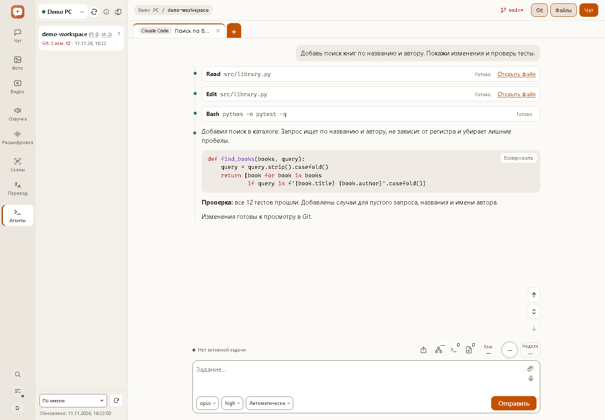
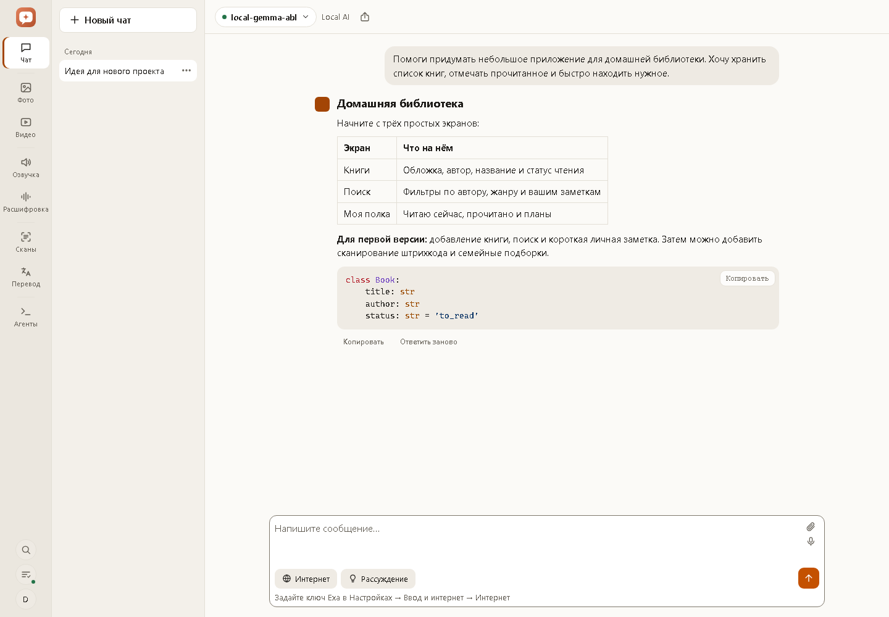
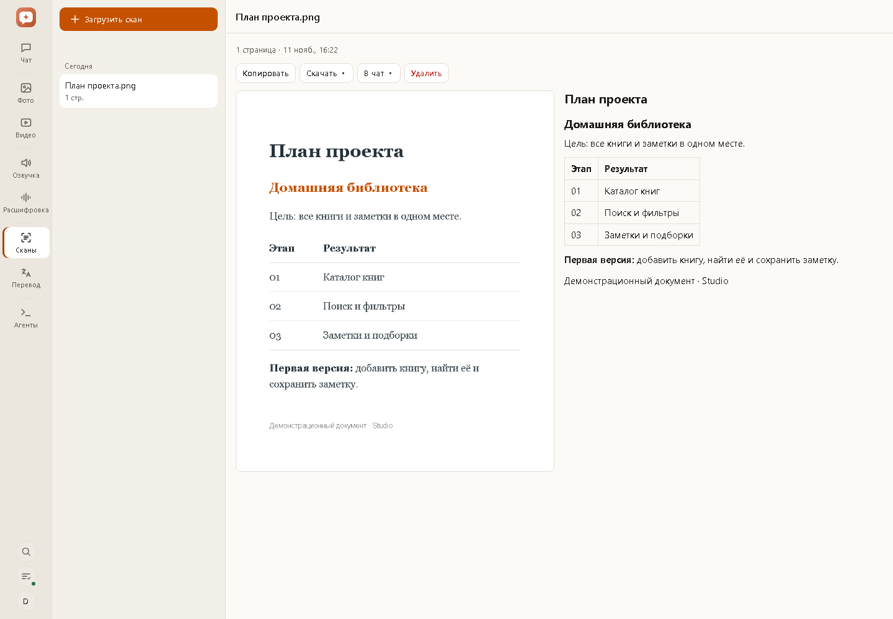
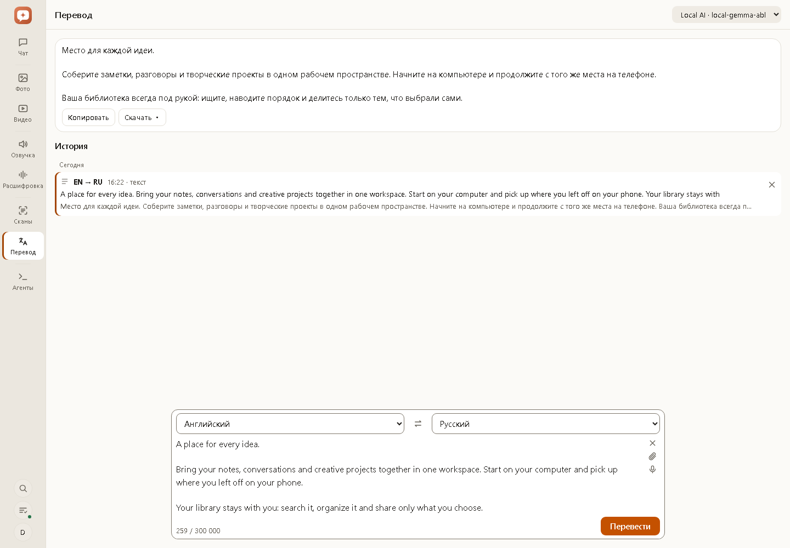
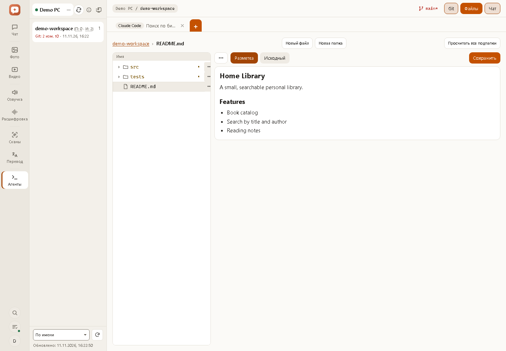
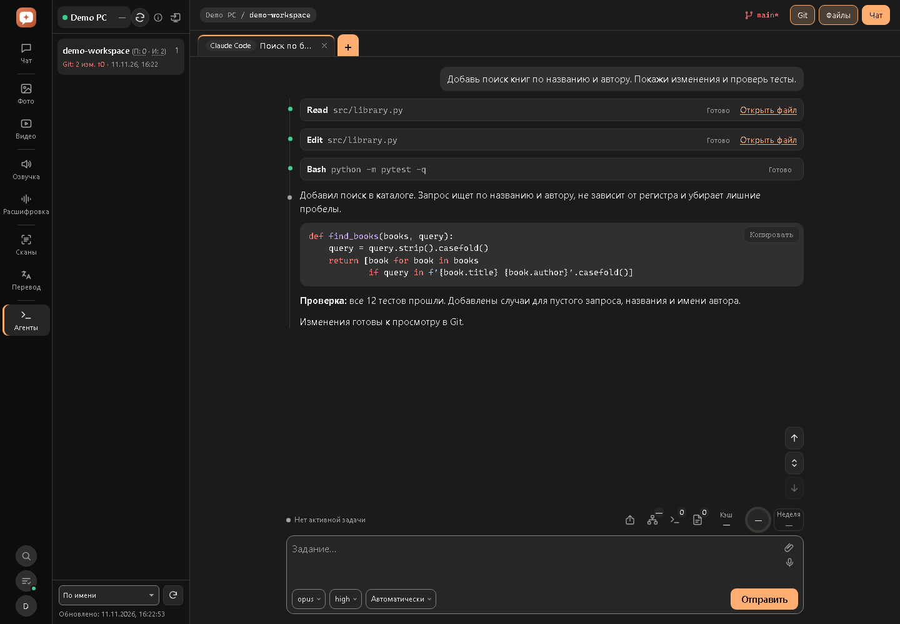
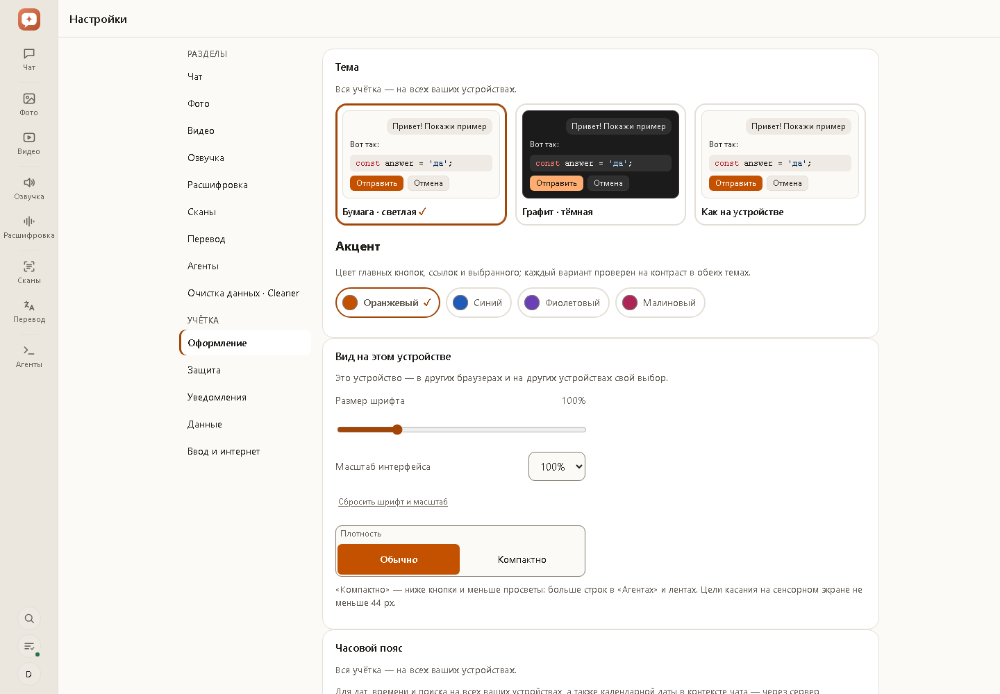
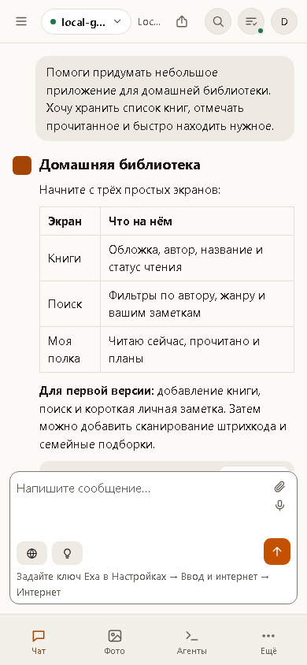
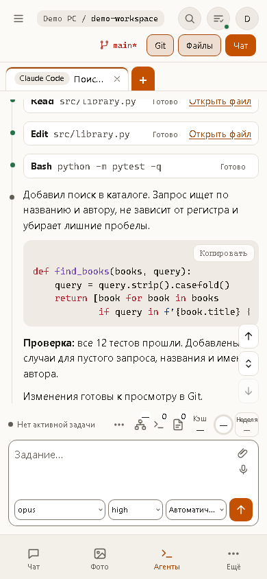
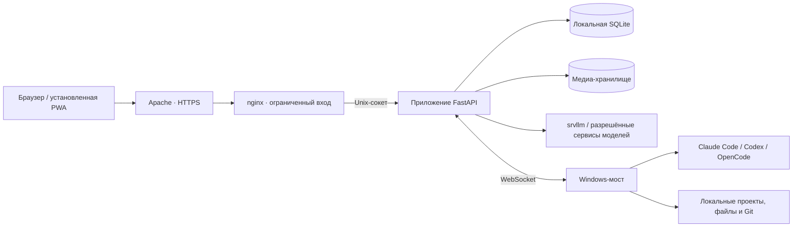

<p align="center">
  
</p>

<h1 align="center">Studio · Студия</h1>

<p align="center">
  <strong>Своя рабочая среда для ИИ на своём сервере.</strong><br>
  Чат, фото, видео, речь, документы и агенты для кода — в одном веб-приложении.
</p>

<p align="center">
  <a href="README.md">English</a> · <a href="README.ru.md"><strong>Русский</strong></a><br>
  <a href="#возможности">Возможности</a> · <a href="#скриншоты">Скриншоты</a> ·
  <a href="#начало-работы">Начало работы</a> · <a href="#документация">Документация</a>
</p>

<p align="center">
  
  
  
  
</p>



Студия объединяет повседневные инструменты ИИ и удалённую работу с кодом в одной учётной записи. Обсудите документ с моделью, создайте картинку и оживите её, расшифруйте встречу, переведите скан или продолжите задание агента с телефона. История, настройки и открытые вкладки агентов доступны на разных устройствах.

Сервер работает на вашей инфраструктуре. Локальные модели подключаются через **шлюз srvllm**, внешние сервисы — через **OpenAI-совместимые API** для поддерживаемых задач. Windows-мост даёт доступ к уже установленным помощникам на ваших компьютерах с их учётками и правилами проектов.

**Восемь разделов:** Чат · Фото · Видео · Озвучка · Расшифровка · Сканы · Перевод · Агенты.

> Интерфейс доступен на русском и английском. Язык выбирается на странице входа или в **Настройках → Оформление** и сохраняется на этом устройстве. Скриншоты сняты с настоящего приложения на вымышленных демонстрационных данных, без личной переписки и рабочих ключей.

## Возможности

### Чат

- Несколько диалогов, выбор модели и постоянная история по дням.
- Потоковые ответы с Markdown, таблицами и подсветкой кода; копирование, остановка и повтор ответа.
- Вложения: изображения, PDF, DOCX, TXT и Markdown. PDF-сканы могут проходить распознавание перед ответом модели.
- Управление рассуждением у поддерживаемых локальных моделей, сворачиваемая история мыслей.
- Поиск и чтение страниц через Exa, субтитры YouTube. Видны вызовы инструментов и сохранённые источники ответа.
- Передача расшифровок и распознанных документов в новый чат с готовым вопросом, запросом итогов или списка задач.
- Ответ через сервер продолжается после закрытия страницы. Для совместимых чат-сервисов доступно прямое подключение из браузера.
- Экспорт полной переписки в **PDF или Markdown**, включая команды и шаги агентов, когда они доступны.

### Фото

- Генерация по тексту и по исходному фото через шлюз, в том числе Lustify и FLUX; поддерживаются совместимые внешние API изображений.
- Портрет, квадрат и альбомный формат; сила изменения у моделей, которые её поддерживают.
- Изменение всего изображения или выделенной кистью области через шлюз.
- Серии из двух–четырёх вариантов, повтор с тем же seed у поддерживаемых моделей, пресеты и просмотр параметров генерации.
- Цепочки промптов и правок, связанные варианты и сравнение двух изображений движущейся границей.
- Описание изображения и перевод промпта на английский локальной моделью.
- Превью, плитка и таблица; выделение диапазонов и целых дней, скачивание ZIP и массовое удаление.
- Передача изображения сразу в «Видео»; на мобильных устройствах — системное меню «Поделиться», где оно поддерживается.

### Видео

- Оживление картинки с устройства или из истории Студии.
- Отдельные описание исходного фото и промпт движения; движение можно поручить модели.
- Параметры шлюза: **1–30 секунд**, **480p / 576p / 720p**, интерполяция до **32 кадров/с**.
- Фоновое создание с прогрессом, отменой, повтором и двумя–четырьмя новыми вариантами.
- Плеер, цепочки промптов, превью/плитка/таблица и массовое скачивание.

### Озвучка и голосовой ввод

- Озвучка текста локальным Qwen3-TTS через шлюз или совместимым внешним сервисом.
- Свои голоса по короткой записи с автоматической расшифровкой ASR и правкой текста либо встроенные голоса провайдера.
- Проба голоса, прослушивание готовых фраз до завершения озвучки и скачивание итогового MP3.
- Диктовка в чате, промптах медиа, переводе и поиске. Текст вставляется на место курсора: его можно проверить перед отправкой.
- Звук голосового ввода обрабатывается без сохранения записи в истории Студии.

### Расшифровка

- Загрузка обычных аудиоформатов и видео со звуком, до **200 МиБ / 60 минут**.
- Разделение по собеседникам через WhisperX шлюза; поддерживаются совместимые внешние API расшифровки.
- Реплики с временем и плеер исходной записи: нажатие на реплику включает нужный момент.
- Правка текста, имена собеседников и сброс изменений без повторного распознавания.
- Экспорт **TXT, DOCX и SRT**, передача в чат для обсуждения, итогов и выделения решений.
- Фоновая обработка, очередь учётки, отмена и состояние ожидания видеокарты.

### Сканы и OCR

- Распознавание PDF и фото документов через HunyuanOCR шлюза, до **50 страниц / 20 МиБ** за загрузку.
- Страница и распознанный Markdown рядом: заголовки, списки и таблицы.
- Просмотр готовых страниц, пока остальные ещё распознаются.
- Повтор неудачных страниц, копирование текста, экспорт **TXT / Markdown / DOCX** и передача в чат.
- Тот же механизм обрабатывает PDF-сканы, приложенные в чате и переводчике.

### Перевод

- Перевод текста, PDF, DOCX, TXT, Markdown и фото выбранной локальной или подключённой моделью.
- Определение языка исходника, смена направления и около **35 языков**.
- Тексты до **300 000 знаков**: деление по абзацам, прогресс и показ готовых частей.
- Распознавание PDF-сканов и фотографий перед переводом.
- Перевод **поверх исходного снимка**, переключение на обычный текст и сохранение изображения с переводом.
- История, копирование, выгрузка TXT/DOCX, повтор на другом языке или модели и продолжение прерванного перевода.
- Отдельные очереди текста и файлов/снимков: короткий абзац можно перевести параллельно с большим документом.
- Дополнительное подключение **Cleaner** для чата и перевода с очисткой данных — подробнее в [руководстве](docs/guide.ru.md#cleaner-чат-и-перевод-с-очисткой-данных).

### Агенты: Claude Code, Codex и OpenCode

Работайте с установленными помощниками на своих Windows-компьютерах из браузера или с телефона.

- Несколько компьютеров и проекты внутри разрешённой папки каждого моста.
- Сводки проектов, счётчики проблем и идей, состояние Git, сортировка и сведения о подключённых компьютерах.
- Продолжение существующих сессий CLI и VS Code и создание новых чатов. Модель, усилие и права выбираются отдельно для каждого помощника.
- Несколько вкладок сессий, перетаскивание мышью и пальцем, управление клавишами и восстановление рабочего места на другом устройстве.
- Поток текста, вызовы инструментов, команды, правки файлов и прогресс; ответы на вопросы и запросы разрешений.
- Уточнения во время задания, очередь следующих сообщений с паузой и правкой, вложения изображений и поддерживаемых документов.
- Сохранённые быстрые действия, порядок предпочтения агентов и умолчания новых чатов.
- Подсказки **@файл** по проекту и поиск в содержимом локальных чатов через мост.
- Ветвление поддерживаемых сессий Claude/Codex, просмотр доступных подзадач и создание **Git-worktree** как отдельных проектов.
- Просмотр и правка файлов, предпросмотр Markdown/PDF/изображений, создание папок, переименование, перемещение и удаление. Проверка конфликтов защищает файл, который уже изменился на компьютере.
- Изменения Git и диффы, ветка и upstream, незапушенные коммиты, все настроенные remotes и синхронизация публичной копии GitHub.
- Действия Git поручают текущему агенту проверить, закоммитить, запушить или выложить проект с учётом его инструкций и действующих прав.
- Контекст, сведения о кэше, расход подписки и сроки сброса лимитов, если установленный помощник их сообщает.
- Просмотр созданных HTML/SVG-визуализаций в изолированном окне.
- Дополнительный доступ к рабочему столу Windows: мониторы, указатель, клавиатура, прокрутка и буфер обмена. Управление экраном включается на мосте.
- Отдельный PIN компьютера, отзыв устройства и обновление моста после завершения активных заданий.
- Работа продолжается на компьютере после закрытия браузера; видны выполняемые сессии, запросы действий и непрочитанные результаты.

Набор функций зависит от возможностей установленного CLI и моста. Переписка агентов и файлы проектов остаются на компьютере; исключение — явно созданный снимок для ссылки «Поделиться», который хранится на сервере зашифрованным.

### Учётки, защита и ссылки

- Администратор приглашает по email, пользователь сам выбирает логин и пароль. Почта обязательна; вход по логину или email, восстановление пароля через почту, дополнительные коды входа по желанию (изначально выключены).
- История пользователей изолирована, ключи подключений зашифрованы.
- Подключения, выбранные модели и умолчания по разделам; разрешённые адреса серверных запросов задаёт администратор.
- Вход по паролю, защита от перебора, управление сессиями и журнал безопасности.
- Блокировка всего приложения или выбранных разделов: PIN приложения, пароль учётки и passkey, включая биометрию устройства, где она поддерживается.
- Аварийный выход завершает сессии, отключает ссылки и уведомления; по выбору — отзывает компьютеры.
- Снимок переписки для чтения по ссылке с **четырёхзначным PIN**, сроком и отзывом. Новая ссылка отключает прежнюю и не даёт доступа к учётке.
- Снимки ссылок зашифрованы ключом сервера; рассуждение добавляется только по явной отметке.
- Промпты, тексты переписки и документов, ключи, медиа и имена файлов не попадают в журналы службы.
- Содержимое получает выбранная для задания модель или сервис. Для локальной обработки нужен соответствующий локальный backend; облачные подключения и включённые веб-инструменты обращаются к внешним сервисам.

### История, уведомления и удобство

- Полнотекстовый поиск по чату, промптам медиа, расшифровкам, сканам, переводам и озвучке с фильтрами раздела, модели и дат.
- Поиск переписки агентов выполняется отдельно на выбранном компьютере через мост.
- Панель «В работе»: фоновые задания, отмена, готовые результаты и сессии агентов, требующие внимания.
- **Web Push** и дополнительная доставка через **ntfy**, настраиваемые для каждого устройства, в том числе Android без сервисов Google.
- Установка как PWA, сенсорные раскладки, навигация клавиатурой и настраиваемые нижние вкладки телефона.
- Светлая, тёмная и системная темы; четыре акцента, размер текста, масштаб, компактная плотность и часовой пояс учётки.
- Объём хранилища, выгрузка и удаление истории, проверка копии и восстановления администратором.
- Ежедневные согласованные копии SQLite с хранением последних копий. Медиа лежат отдельно, база — на локальном диске.

## Скриншоты

Нажатие открывает изображение в полном размере. В [полной галерее](docs/screenshots/README.md) — описание экранов и воспроизводимая команда съёмки.

| Чат | Сканы и OCR |
| --- | --- |
| [](docs/screenshots/chat.png) | [](docs/screenshots/ocr.png) |
| Перевод | Файлы и Markdown |
| [](docs/screenshots/translation.png) | [](docs/screenshots/files.png) |
| Тёмная тема | Оформление |
| [](docs/screenshots/agents-dark.png) | [](docs/screenshots/appearance.png) |

<p align="center">
  <a href="docs/screenshots/chat-mobile.png"></a>
  &nbsp;
  <a href="docs/screenshots/agents-mobile.png"></a>
</p>

## Начало работы

Студия — приложение для работы с моделями. Сами модели и сервисы инференса настраиваются отдельно.

| Компонент | Что нужно |
| --- | --- |
| Сервер | Linux, Docker Compose и systemd; готовый профиль также использует Apache как HTTPS-прокси |
| Данные | Локальный диск для SQLite; готовый Docker-профиль ожидает смонтированную CIFS-шару для медиа |
| Модели | Шлюз srvllm для полного локального сценария медиа/OCR; OpenAI-совместимые API для отдельных поддерживаемых задач |
| Агенты для кода | Windows-компьютер, мост Студии и хотя бы один установленный Claude Code, Codex или OpenCode CLI с выполненным входом |
| Дополнительно | Exa для интернета в чате, Web Push или HTTPS-сервер ntfy для уведомлений, Cleaner для очистки данных |

1. Склонируйте репозиторий: `git clone https://github.com/guru431/studio.git`.
2. По [инструкции Docker](docs/architecture/deploy-docker.md) настройте хосты, медиа-хранилище, Apache и игнорируемый `deploy/local-profile.sh`.
3. Подготовьте постоянный `STUDIO_DATA_KEY` и учётку первого администратора через поток секретов из [правил публикации и установки](docs/publication.md). Храните резервную копию ключа вместе с копиями данных.
4. Выложите закоммиченную версию командой `bash deploy/deploy.sh`; явные параметры `--new-secret` и `--create-admin` доставляют ключ и создают первую учётку.
5. Войдите, добавьте подключения и выберите модели разделов. Для удалённой работы с кодом подключите Windows-мост из «Агентов».

Готовые скрипты рассчитаны на управляемую установку с SSH, общим хранилищем медиа и отдельным HTTPS-прокси. Им нужен локальный профиль; шлюз инференса этот репозиторий не разворачивает. Адреса и пути в отслеживаемых примерах — условные.

### Разработка

Фронтенд использует стандартные ES-модули и локальные копии библиотек: **без этапа сборки и CDN**.

Windows, из корня репозитория:

```powershell
py -3.13 -m venv .venv
.venv\Scripts\python -m pip install -r requirements-dev.txt
.venv\Scripts\python -m pytest -q
```

Быстрые тесты используют изолированные базы и подставные сервисы. Браузер, PowerShell и живая приёмка моделей проверяются отдельно — [контракт тестов](docs/architecture/testing.md).

Повторить скриншоты при установленных Edge/Chromium и зависимостях разработки:

```powershell
.venv\Scripts\python tools/capture_screenshots.py
```

### Пакетные клиенты

Для картинок есть [PowerShell](client/studio-batch.ps1) и [Python](client/studio-batch.py), для видео — [PowerShell](client/studio-video.ps1) и [Python](client/studio-video.py). Скрипты обращаются к шлюзу напрямую и позволяют выполнять пакетные задания без веб-приложения. Python-версии используют только стандартную библиотеку и работают в Linux/macOS и Windows. Ключ шлюза хранится в локальной конфигурации, а не в отслеживаемых скриптах.

## Архитектура



Сервер — FastAPI, SQLite/FTS5 и зашифрованные ключи подключений. Образ включает ffmpeg, Chromium и yt-dlp для звука, экспорта PDF и субтитров. Windows-мост входит в этот репозиторий и находится в [agent/](agent/).

## Документация

| Материал | Для чего |
| --- | --- |
| [English overview](README.md) | Полное описание проекта на английском |
| [Руководство пользователя](docs/guide.ru.md) | Подробные сценарии, пределы, настройки и неполадки |
| [Галерея скриншотов](docs/screenshots/README.md) | Настольные и мобильные экраны, повторная съёмка |
| [Устройство по областям](docs/architecture/README.md) | Текущее поведение подсистем |
| [Docker-установка](docs/architecture/deploy-docker.md) | Установка, копии, перенос и откат |
| [Публикация и локальный профиль](docs/publication.md) | Публичные примеры, личные настройки и секреты |
| [Windows-мост](agent/README.md) | Установка, учётки, доступ и совместимость |
| [Тесты](docs/architecture/testing.md) | Быстрые, интеграционные и живые проверки |
| [Глоссарий](docs/glossary.md) | Названия разделов и элементов интерфейса |
